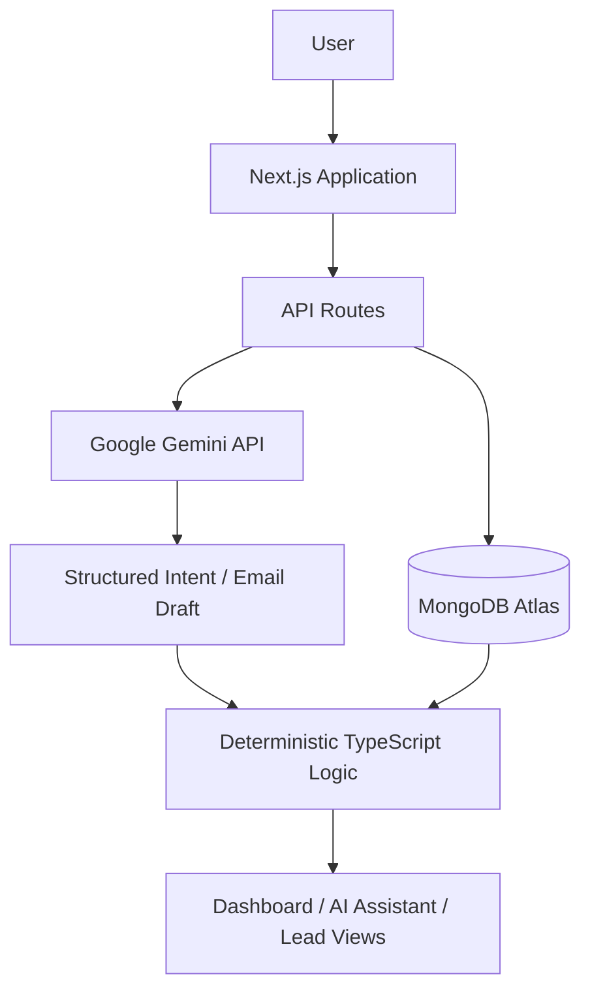

<div align="center">

# BIAI Sales Intelligence

### A smarter way to manage corporate leads, track sales opportunities, and uncover pipeline insights.

A lightweight AI-assisted CRM built for the BIAI AI Intern Round 2 assessment.

<br />


<br />

[Live Demo](https://biai-sales-intelligence.vercel.app/) 

</div>

---

## Overview

**BIAI Sales Intelligence** is a small corporate sales CRM designed to help a sales team organize leads, monitor deal progress, identify follow-up priorities, and maintain reliable customer records.

The application combines a traditional lead-management workflow with AI-assisted interactions. Users can manage lead information through a centralized dashboard, identify data-quality problems, and ask questions about their sales pipeline using natural language.

Rather than relying on AI to calculate business figures, the system uses deterministic TypeScript logic for filtering, calculations, overdue detection, and data-quality analysis. Google Gemini is used to interpret natural-language questions and generate contextual follow-up email drafts.

> Built with a practical approach: structured data, explainable business rules, and AI where it adds value.

## Features

### 01. Sales Dashboard

- Overview of total leads and aggregate deal value.
- Sales pipeline breakdown across all seven stages.
- Overdue follow-up summary with recommended actions.
- Upcoming follow-up overview.
- Data-quality issue counts and duplicate-pair visibility.
- Quick navigation to relevant lead records.

### 02. Lead Management

- Centralized list of corporate leads.
- Lead details including company, industry, contact information, source, deal value, and notes.
- Seven-stage sales pipeline:
  `New → Contacted → Meeting → Proposal → Invoice sent → Paid / Lost`
- Search and filtering by company, contact, stage, industry, overdue status, and data-quality issues.
- Edit existing lead information.

### 03. Data Quality & Duplicate Detection

Automatically identifies records that need attention:

- Missing contact information.
- Contradictions between notes and contact fields.
- Suspicious email addresses.
- Invalid contact/follow-up date sequences.
- Sales-stage and payment inconsistencies.
- Exact and probable duplicate records.

Duplicate records are flagged for human review rather than silently deleted or merged.

### 04. AI-Powered Follow-up Drafts

Generate short, professional follow-up email drafts using Google Gemini.

- Uses the lead's stage, contact information, and notes as context.
- Adapts the message to the current sales stage.
- Avoids inventing meetings, payment status, or other unsupported details.
- Produces editable subject and email-body content.
- Supports human review before sending.

**Note:** The application generates drafts only; it does not send emails.

### 05. Natural-Language AI Assistant

Ask questions about the sales pipeline in plain English, Bangla, or Banglish.

Example questions:

- Which deals are overdue?
- What is the total value of deals in the Proposal stage?
- Show me all duplicate leads.
- Which leads have missing contact information?
- Which leads are waiting for payment?
- Find Padma Textiles.

The AI translates a question into a structured intent. The application then retrieves the relevant MongoDB records and calculates the answer using deterministic business logic.

---

## How It Works

The application separates AI interpretation from business calculations to keep results consistent and explainable.



**AI handles:**
- Understanding natural-language questions.
- Generating contextual follow-up email drafts.

**Application logic handles:**
- Lead filtering and retrieval.
- Deal-value calculations.
- Stage summaries.
- Overdue follow-up detection.
- Data-quality validation.
- Duplicate detection.
- Final answer construction.

This approach avoids relying on an LLM for arithmetic or critical business-rule calculations.

## Technology Stack

| Category | Technologies |
|---|---|
| Frontend | Next.js App Router, React, TypeScript |
| Styling | Tailwind CSS |
| UI Icons | Lucide React |
| Database | MongoDB Atlas, Mongoose |
| AI Integration | Google Gemini API, `@google/genai` |
| Validation | Zod |
| CSV Processing | PapaParse |
| Development | Node.js, npm, Git, GitHub |
| Deployment | Vercel |

## Project Structure

```text
biai-corporate-leads/
├── data/
│   └── corporate-leads.csv
├── scripts/
│   ├── check-logic.ts
│   ├── import-leads.ts
│   └── test-gemini.ts
├── src/
│   ├── app/
│   │   ├── api/
│   │   │   ├── ask/
│   │   │   ├── dashboard/
│   │   │   ├── health/
│   │   │   └── leads/
│   │   ├── assistant/
│   │   ├── leads/
│   │   ├── layout.tsx
│   │   ├── not-found.tsx
│   │   └── page.tsx
│   ├── components/
│   ├── lib/
│   │   ├── askEngine.ts
│   │   ├── askInterpreter.ts
│   │   ├── gemini.ts
│   │   ├── leadLogic.ts
│   │   ├── leadService.ts
│   │   ├── mongodb.ts
│   │   └── prompts.ts
│   └── models/
│       └── Lead.ts
├── .env.example
├── package.json
└── README.md
```

## Getting Started

### Prerequisites

Make sure you have the following:

- Node.js (LTS recommended).
- npm.
- A MongoDB Atlas account and database connection string.
- A Google Gemini API key with access to your selected model.

### 1. Clone the repository

```bash
git clone https://github.com/tasdid-ahmed/biai-corporate-leads.git
cd biai-corporate-leads
```

### 2. Install dependencies

```bash
npm install
```

### 3. Configure environment variables

Create a `.env` file in the project root using `.env.example` as a reference.

```env
MONGODB_URI=your_mongodb_connection_string
GEMINI_API_KEY=your_gemini_api_key
GEMINI_MODEL=your_available_gemini_model
```

The MongoDB connection uses the database name `biai_crm`.

Keep your credentials private. Never commit `.env` or expose server-side API keys in client-side code.

### 4. Import the sample dataset

The project includes 25 fictional corporate lead records in:

`data/corporate-leads.csv`

Import them into MongoDB:

```bash
npm run db:import
```

The import script uses upsert operations and does not overwrite existing lead records when the script is run again.

**Optional reset:** To clear the existing leads collection and re-import the CSV:

```bash
npm run db:import -- --reset
```

Use this command carefully. It deletes the existing lead records before importing the sample dataset.

### 5. Run the development server

```bash
npm run dev
```

Open [http://localhost:3000](http://localhost:3000) in your browser.

## Available Scripts

| Command | Description |
|---|---|
| `npm run dev` | Start the Next.js development server |
| `npm run build` | Create a production build |
| `npm run start` | Start the production server |
| `npm run lint` | Run ESLint |
| `npm run db:import` | Import sample leads into MongoDB |
| `npm run check:logic` | Run deterministic business-logic checks |

The logic-check script connects to MongoDB and validates the imported assessment dataset.

## Assessment Dataset & Business Rules

The application uses a fictional dataset of **25 corporate leads**.

For consistent assessment results, the business logic uses a fixed reference date:

`2026-11-01`

A lead is considered overdue when its next follow-up date is strictly earlier than the reference date, provided that:

- The lead is not in the `Paid` or `Lost` stage.
- Its follow-up date is not earlier than its last-contact date.
- A missing follow-up date is not treated as overdue.

The validation script checks important expected outcomes, including:

- 25 leads successfully loaded.
- 8 valid overdue follow-ups.
- Exact duplicate pair: L01 / L23.
- Probable duplicate pair: L02 / L03.
- Invalid date-order handling for L25.
- Payment-stage inconsistency for L12.
- Suspicious email detection for L18.
- Missing contact information for L24.
- Proposal-stage total value of BDT 1,620,000.

The reference date is intentionally fixed for the assessment dataset; it is not a live system date.

## AI Integration & Limitations

Google Gemini is integrated for natural-language interpretation and email-draft generation.

The AI integration depends on the configured Gemini model and the API project's available quota. Free-tier rate limits may temporarily make AI-powered features unavailable.

During development and testing, the Gemini free-tier daily request quota was exhausted. As a result, AI functionality may return a quota/rate-limit error until the quota resets or additional API capacity becomes available.

The core CRM features—including database operations, lead management, dashboard calculations, overdue detection, and data-quality analysis—use application logic and MongoDB rather than Gemini.

Other current limitations:

- The reference date is fixed to the assessment date.
- Duplicate records are flagged, not automatically merged.
- Email drafts require human review and are not sent automatically.
- The application is an assessment prototype, not a production CRM with a complete authentication and authorization system.
- It is intended for fictional assessment data, not real customer information.

## Future Improvements

- Authentication and role-based access control.
- API rate limiting and abuse protection.
- Configurable reference dates.
- CSV export and reporting.
- More advanced pipeline analytics.
- Improved audit history for lead updates.
- Additional AI-assisted insights with usage controls.

---

<div align="center">

### Built for the BIAI AI Intern — Round 2 Assessment

**BIAI Sales Intelligence**

*Structured data. Explainable logic. Practical AI.*

</div>
